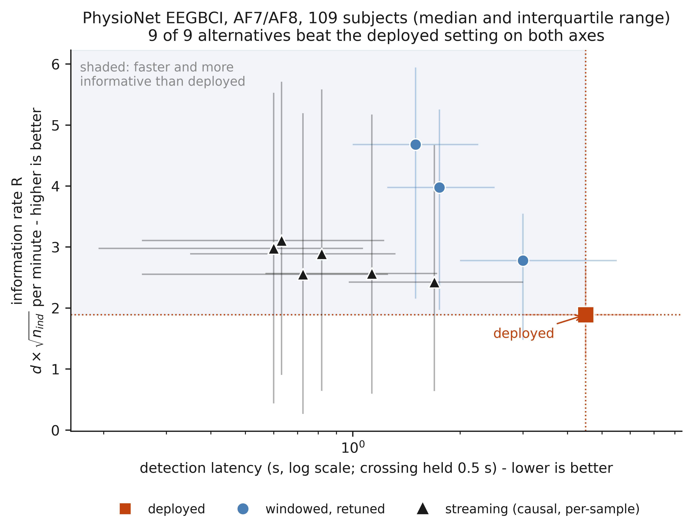
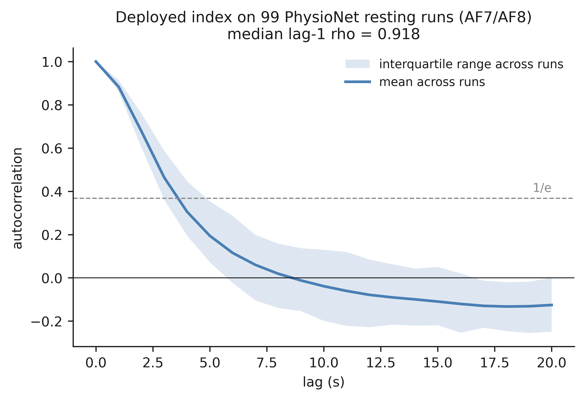
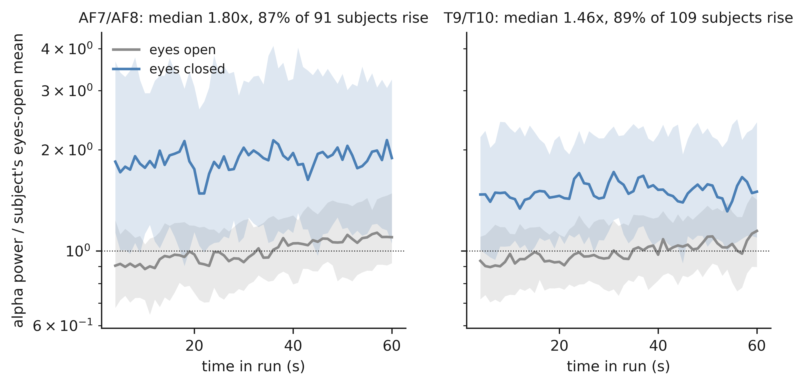

# Measuring and Decomposing Latency in a Closed-Loop EEG Music System

Kirthan Kulkarni

> Readable copy of `arxiv_short.tex`, which is the version submitted. Keep the two in step.
> Every quantitative claim is regenerated by `python scripts/verify_claims.py`.

---

## Abstract

Several closed-loop systems that continuously adapt music to a user's electroencephalogram
(EEG) have been implemented in the past, yet none of the systems that we could examine
reports a measured end-to-end latency, even though neurofeedback studies find that feedback
effects weaken at a 0.5–1 second latency. We present a closed-loop EEG music system which
utilizes consumer hardware, and measure its latency component by component. The system
estimates arousal using a frontal log(β/α) index, maps it onto a nine-level prompt ladder
following the iso-principle, and plays audio from a library of pre-rendered MusicGen
segments. Music generation runs 1.05–6.27× slower than real time in every configuration
that was tested, which motivates the precomputed library setup. Employing a precomputed
library reduces worst-case audio latency from 8.0 s to 1.0 s. The deployed end-to-end
latency is 6.5 s, of which 84.6% is attributable to the analysis path rather than the
generative model. Evaluated on labelled eyes-open/eyes-closed transitions from 109 subjects
of a public EEG dataset, the deployed estimator is worse than all 9 alternative
configurations on both detection latency and information rate. The architecture shows an
analysis-path floor of 0.189 s and end-to-end latency of 0.439 s, at which information rate
is 1.50× that of the deployed configuration. We also report four statistical properties of
closed-loop EEG data that are relevant to study design. All EEG results use public datasets
or synthetic signals, and all 56 quantitative claims are regenerated by a single Python
script. No claim of therapeutic efficacy is made.

**Keywords:** closed-loop systems · EEG · latency · neurofeedback · music generation ·
reproducibility

---

## 1. Introduction

Music listening is a non-invasive way to influence a user's affective state, and recent
research seeks to make it adaptive by closing the loop through the user's brain activity.
Such systems record EEG continuously and estimate an affective state from it. The music
changes in response. Several of these systems have
been built and described [1–3, 5, 6], and this area has already been reviewed [4].

These systems are typically described as real-time, but the time they take to respond has
not been studied much. In neurofeedback, delay is itself an experimental variable:
Belinskaia et
al. [7] trained parietal alpha with feedback delayed by 0, 250 and 500 ms and found that
sustained post-training change was negatively correlated with latency and absent at 500 ms.
Asai et al. [8] compared feedback delays of 0, 1 and 20 s and found that the trained EEG
microstate increased significantly only when feedback was not delayed.

In this work, we build a closed-loop EEG-based music system on consumer hardware (Muse 2)
and analyze its latency. The system consists of a four-channel Muse headband, a frontal
arousal index normalised to each listener's baseline, a controller that applies the
iso-principle over a nine-level prompt ladder, and an audio engine that selects from a
library of pre-rendered segments rather than generating music online. We decompose the
end-to-end delay into its analysis and audio components. Alternative estimator
configurations are then evaluated against labelled ground truth to find the lowest latency
the architecture can reach.

Our contributions are summarised as follows:

1. We report a measured latency budget for a closed-loop EEG music system,
   and show that most of the delay (84.6% of 6.5 s) comes from processing the EEG signal
   rather than generating the music.
2. On public EEG from 109 subjects, we show that the deployed estimator is worse than all 9
   alternatives on both detection latency and information rate, and that the system's
   latency floor (0.439 s end-to-end) is 1.50× as informative as the deployed setting.
3. We demonstrate that, for a controller with a finite prompt space, a precomputed audio
   library is preferable to online generation independently of generator speed, and
   reduces worst-case audio latency by a factor of 8.
4. We identify four statistical properties of closed-loop EEG data that affect the design
   and analysis of studies using such systems, and calibrate one of them against synthetic
   ground truth.

---

## 2. Related Works

### 2.1 Closed-Loop EEG Music Systems

Recent systems differ widely in how they decode affect and how they produce music.
MindMelody decodes valence and arousal with a Transformer-GNN encoder and plans
interventions with a retrieval-augmented language model, then conditions MusicGen-medium on
the result [1]. It reports 76.8% accuracy for valence and 72.4% for arousal across subjects
on DEAP. Ran et
al. generate emotional music in real-time from EEG [2]. Ehrlich et al. demonstrate a
closed-loop system with synthesised, affective music [3]. Velasquez-Peña et al. control
Ableton Live via a consumer-grade Muse S headband [5], while Monroy-D'Croz et al. design a
minimal interface driven by prefrontal EEG, using the Lab Streaming Layer [6]. In each case,
EEG is used to shape the music, and most of these systems decode affect with more
sophistication than the single index used here. We make no claims to better decoding
performance than these methods.

None of these works report a measured latency from when the signal is obtained to audio output.
MindMelody reports neither latency nor inference time, and does not specify its hardware.
Monroy-D'Croz et al. state a 4 s sliding window with 0.5 s updates but report no latency and
no control condition. Ehrlich et al. come closest. Their feedback loop uses a 4 s analysis
window at 87.5% overlap (0.5 s step), with zero-phase filtering chosen to avoid delaying the
signal, and they tuned their feedback parameter to match the subjective impression of
latency. They do not report an end-to-end value.

### 2.2 Feedback Latency

Delay is treated as a primary variable in neurofeedback [7, 8] and as a design requirement in
interactive music generation; Gesture2Music, for example, reports 25–30 ms inference
latency against the 100 ms threshold commonly regarded as acceptable for real-time
interaction [9]. We apply the same standard to EEG-driven music.

### 2.3 The Iso-Principle

The iso-principle holds that music should first match a listener's present state and then
lead it gradually toward a target [10]. Its supporting evidence comes largely from fixed,
non-adaptive sequences: Starcke et al. randomised 107 participants to four pre-set sequences
after a sadness induction. Group differences after listening were significant for positive
affect and valence (η² = 0.08 and 0.09), with the iso sequence scoring highest, although
not significantly above a sequence of two happy pieces [11]. The sequences were fixed in
advance and did not respond to the listener. However, a larger, pre-registered study did
not replicate this advantage: Lowe-Brown et al. randomised 193 participants after an
anxiety induction to iso, compensatory or unguided playlists built from their own songs.
They found no significant difference between iso and compensatory listening, although
exploratory analyses showed greater increases in calmness after either guided playlist than
after unguided listening [15]. The evidence for the iso-principle is therefore mixed. We
return to the implications of this in Section 8.

---

## 3. System Design

### 3.1 Overview

The system forms a loop of four stages: acquisition, arousal estimation, prompt selection
and audio rendering. A Muse 2 headband streams four EEG channels at 256 Hz over Lab Streaming
Layer. An arousal index is computed over sliding windows, normalised to the listener's
baseline, and mapped by the controller to one of nine text prompts. The audio engine plays
segments associated with the current prompt and crossfades to a new segment when the prompt
changes.

### 3.2 Arousal Estimation

The frontal channels AF7 and AF8 are averaged. Each window of length W is detrended,
band-pass filtered between 1 and 45 Hz, notch filtered at 60 Hz, and transformed with
Welch's method [12] to obtain band powers P_α and P_β. The raw index

  I_t = log( P_β(t) / P_α(t) )                                              (1)

is computed every hop H and smoothed with a one-pole filter of time constant τ:

  s_t = (1 − a) s_{t−1} + a I_t,   a = 1 − exp(−H/τ)                         (2)

The smoothed index is standardised against a 120 s eyes-open baseline with mean μ_b and
standard deviation σ_b:

  z_t = (s_t − μ_b) / σ_b                                                    (3)

Windows exceeding a 350 µV peak-to-peak amplitude are rejected and do not update the
smoother. The deployed configuration uses W = 4 s, H = 1 s and τ = 3 s.

### 3.3 Prompt Controller

The controller quantises z_t onto a ladder of nine rungs, each spanning 0.5 standard
deviations and centred on rung c = 4:

  k_t = clip( c + round(z_t / w), 0, 8 ),   w = 0.5                          (4)

Following the iso-principle, the controller does not move directly to the target rung k*,
obtained by applying the same mapping to the target z*, but plays the rung adjacent to the
listener's current rung in the direction of the target:

  k̂_t = k*                      if |z_t − z*| ≤ δ
  k̂_t = k_t + sgn(k* − k_t)     otherwise                                    (5)

where δ = 0.35 is a deadband within which the listener is considered to be at the target.
For relaxation, z* = −1. Each rung corresponds to one text prompt, so the controller's output
space consists of exactly nine strings. A minimum dwell time D prevents a new prompt change
until D seconds have elapsed since the previous one.

### 3.4 Audio Engine

Each of the nine prompts has 32 pre-rendered 8 s segments, generated offline with MusicGen
[13], for a total of 288 segments (38.4 minutes). When the prompt changes, the current
segment is abandoned and the engine performs an equal-power crossfade of duration T_xf into
a segment from the new rung.

Two properties motivate this design. The controller emits only nine distinct prompts, so a
library covers its entire output space exactly, and re-synthesising one of nine prompts
online would be redundant even with an arbitrarily fast generator. Latency is the other
reason. A streaming generator must play each queued segment to completion, so its audio
latency is bounded by the queue rather than by generation speed:

  L_audio(stream) ≤ Q · S,   L_audio(library) ≤ T_xf                         (6)

where Q is the queue depth and S the segment duration. In our configuration this reduces
the worst-case audio latency from 8.0 s to 1.0 s.

---

## 4. Latency Characterisation

### 4.1 Experimental Setup

**Generation benchmark.** We measured MusicGen throughput in nine benchmark runs spanning two
GPU tiers (a laptop GPU and a datacenter NVIDIA T4), two inference backends (Hugging Face
Transformers and Audiocraft) and three precision modes (fp32, fp16 with autocast, and fp16
with half-precision weights), giving 44 configuration cells.

**Ground truth for the analysis path.** No EEG was recorded for this paper. Estimator
configurations were evaluated on the PhysioNet EEG Motor Movement/Imagery Dataset [16, 17],
loaded with MNE-Python [18]. Each of its 109 subjects has a one-minute eyes-open and a
one-minute eyes-closed resting run, recorded at 160 Hz with a 64-channel cap. The dataset
includes AF7 and AF8, the channels of the arousal index. It has no TP9 or TP10, so the nearest
temporal sites, T9 and T10, stand in for them. For each subject we joined eyes-open 0–30 s,
eyes-closed 0–60 s and eyes-open 30–60 s into a 120 s session with one rising and one falling
transition. Segments were mean-centred and crossfaded over 50 ms so that the join adds no
step. A spliced transition is instantaneous, while a real eye closure takes time to raise
alpha, so the measured detection latencies are upper bounds on the estimator alone. We also
generated 50 synthetic sessions at the Muse's 256 Hz, each with six alternating 60 s blocks
of 1/f background and an alpha component whose power steps by a factor of 1.34 at every block
boundary. All estimators were run through the deployed feature extractor at the dataset's own
sampling rate.

### 4.2 Metrics

The analysis-path latency of a windowed estimator is the sum of the window centroid delay,
the mean hop quantisation delay and the smoother's group delay:

  L_analysis = W/2 + H/2 + τ,   L_total = L_analysis + L_audio               (7)

*Detection latency* is the time from a labelled transition to the first point at which the
estimator crosses the midpoint between the two state means and stays across it for at least
0.5 s. A crossing that is undone sooner is counted as noise. Without this rule the noisiest
estimators would be credited with chance crossings. For windowed estimators, whose outputs
arrive every 0.5 or 1 s, the rule changes nothing; it matters only for the streaming ones.
Each configuration is scored per subject and summarised by the median across subjects.
Discriminability d is the standardised difference in the estimator's output between
eyes-closed and eyes-open data at least 8 s from a transition. Because consecutive outputs
are autocorrelated, we also compute the number of independent observations per minute,

  n_ind = (60 / H) · (1 − ρ) / (1 + ρ)                                       (8)

where ρ is the lag-1 autocorrelation of the output on a 1 s grid. We score each
configuration by its information rate

  R = d · √n_ind                                                             (9)

the t-statistic per square-root minute, which governs how precisely a session of fixed
duration resolves a difference in state. Latency alone would favour no smoothing, and
discriminability alone would favour smoothing everything to a constant; R balances the two.

### 4.3 Generation Throughput

Every one of the 44 configuration cells ran between 1.05× and 6.27× slower than realtime,
with the best case on the datacenter T4. The bottleneck is the sequential autoregressive
decode loop rather than arithmetic throughput: on the T4, fp32 outperformed fp16 with
half-precision weights by a factor of 0.952, and the ordering fp32 < fp16-half < fp16 held in
6 of 6 cells. Autocast inserts a type conversion at every operation, a cost that is
amortised in large batched training workloads but not in batch-1 decoding. Between-run
variation for an identical configuration reached 1.96× on the thermally limited laptop and
1.18× on the T4, so single-run measurements on consumer GPUs should be reported as ranges.

### 4.4 End-to-End Latency Budget

Table 1 decomposes the deployed latency. The analysis path contributes 5.5 s, comprising
2.0 s of window centroid delay, 0.5 s of hop quantisation and 3.0 s of smoother group delay.
With a 1.0 s crossfade, the worst-case end-to-end latency is 6.5 s, of which 84.6% is
analysis. Against the PhysioNet transitions the deployed estimator's median detection
latency is 4.50 s. This is shorter than the budget for a simple reason. A midpoint crossing
needs the smoother to cover half of a step, which takes τ ln 2 = 2.08 s rather than τ, so the
expected crossing time is W/2 + H/2 + τ ln 2 = 4.58 s.

**Table 1.** Deployed end-to-end latency budget.

| component | latency (s) |
|---|---|
| window centroid (W/2, W = 4 s) | 2.0 |
| hop quantisation (H/2, H = 1 s) | 0.5 |
| smoother group delay (τ = 3 s) | 3.0 |
| **analysis path** | **5.5** |
| audio crossfade (T_xf) | 1.0 |
| **end-to-end** | **6.5** |

### 4.5 Estimator Comparison

Table 2 compares the deployed estimator with two representative alternatives, and Figure 1
shows all ten configurations. On the medians across 109 subjects, all nine alternatives are
both faster and more informative than the deployed setting. The deployed setting is therefore
not a latency–accuracy trade-off. It lies off the efficient frontier. The result does not
depend on the scoring rule or the data: it is also 9 of 9 under the first-crossing rule, on
T9/T10, and on the 50 synthetic sessions. Medians can hide individual subjects, so we also
counted them. The retuned windowed configuration beat the deployed one on both axes in 78.5%
of subjects.

**Table 2.** Representative estimator configurations on PhysioNet EEGBCI (AF7/AF8, 109
subjects, medians).

| configuration | detection (s) | d | n_ind/min | R |
|---|---|---|---|---|
| deployed (W = 4 s, H = 1 s, τ = 3 s) | 4.50 | 2.07 | 0.9 | 1.89 |
| windowed (W = 2 s, H = 0.5 s, τ = 0.5 s) | 1.50 | 1.35 | 10.9 | 4.68 |
| streaming (order 4, τ = 0.25 s) | 0.63 | 0.41 | 47.3 | 3.11 |

**Figure 1.** Detection latency against information rate R for each estimator configuration,
PhysioNet EEGBCI, AF7/AF8, 109 subjects. Points are medians and bars interquartile ranges
across subjects. The shaded region contains configurations that improve on the deployed
setting on both axes; all 9 alternatives fall inside it.

The principal cause is the smoother. At τ = 3 s, consecutive outputs are nearly identical
(ρ = 0.972), yielding only 0.9 independent observations per minute. The smoother is
therefore simultaneously the largest latency term and the main source of the autocorrelation
discussed in Section 5; reducing τ improves both.

### 4.6 Latency Floor

A causal streaming estimator has no window centroid or hop quantisation, so its only delays
are filter group delay and smoothing. A second-order design with τ = 0.1 s reaches an
analysis-path latency of 0.189 s. Table 3 combines analysis-path and crossfade durations and
compares each total with the 500 ms delay at which Belinskaia et al. [7] no longer observed a
training effect.

**Table 3.** End-to-end latency by configuration, relative to the 500 ms delay of Belinskaia
et al.

| analysis path (s) | crossfade (s) | end-to-end (s) | ratio to 500 ms |
|---|---|---|---|
| deployed, 5.500 | 1.00 | 6.500 | 13.0 |
| retuned, 1.750 | 1.00 | 2.750 | 5.5 |
| floor, 0.189 | 1.00 | 1.189 | 2.4 |
| floor, 0.189 | 0.25 | 0.439 | 0.9 |

At the floor, the crossfade becomes the largest term, so the dominance of the analysis path
is a property of the configuration rather than of the architecture. Moving to the floor does
not lower the information rate. Per-window discriminability falls from d = 2.07 to 0.39, but
the number of independent observations rises from 0.9 to 49.7 per minute, and the
information rate is 1.50× that of the deployed configuration. The floor is not the most
informative setting, though. That is the retuned windowed configuration, at R = 4.68, which
trades about a second of extra latency for it.

These results have limits. Detection latency does not keep falling with the budget: at the
floor the median is 0.63 s, and below τ = 0.1 s it rises again, because the output becomes
noisy enough that crossings no longer hold for 0.5 s. Under the first-crossing rule the same
estimators appear to detect in 0.10–0.16 s, which is the flattery the hold rule exists to
remove. The eyes-open/eyes-closed contrast is also considerably larger than the contrast
expected between adaptive and non-adaptive music. No session has been run at these
settings, so the floor is characterised offline rather than in deployment.

### 4.7 Controller Stability at Low Latency

Adopting a faster estimator also requires changes to the controller. We drove the real
controller with z series reconstructed from 66 PhysioNet sessions, every one with enough
clean eyes-open windows to form a baseline (132 minutes in total). Through the W = 2 s,
H = 0.5 s, τ = 0.5 s configuration, 4176 of 6986 prompt changes arrived before the preceding
crossfade had completed, or 31.7 per minute. At the deployed settings there were none. A
less smoothed index crosses rung boundaries frequently. Imposing a minimum dwell D ≥ T_xf
guarantees that no change begins before the previous crossfade ends, and reduces the count
to 0 on both the PhysioNet and the synthetic sessions. The dwell adds to worst-case latency,
which becomes L_analysis + D + T_xf.

---

## 5. Statistical Properties of Closed-Loop EEG Data

### 5.1 Autocorrelation

Across 99 unspliced PhysioNet resting runs with no rejected windows, the deployed index on
AF7/AF8 has a median lag-1 autocorrelation of ρ = 0.918. The 40 one-minute DEAP trials of
participant 1 give the same value on AF3/AF4 (ρ = 0.918). For a 20-minute session at a 1 s
hop, the AR(1) effective sample size

  N_eff = N · (1 − ρ) / (1 + ρ)                                              (10)

is 51.0 of 1200 windows. A test that treats the windows as independent therefore overstates
its test statistic by √(1200/51.0) = 4.85×. Figure 2 shows that the index falls below 1/e
within 4 s, a time scale set largely by the smoother rather than by the listener. One-minute
runs contain none of the slow drift of a longer session, so these values are lower bounds on
the autocorrelation a closed-loop session would show.

**Figure 2.** Autocorrelation of the deployed arousal index as a function of lag, across 99
PhysioNet resting runs (AF7/AF8).

### 5.2 Continuous Audio-Neural Coupling

Cross-correlating the audio envelope with the neural index over a full session loses
statistical power precisely when the intervention succeeds. A listener who reaches the target
and remains there holds the controller on a single rung, leaving little controller-driven
variation in the audio to correlate. The estimator itself is sound: it recovers a known 6 s
lag exactly from synthetic data. The limitation therefore lies in the outcome measure, not in
the estimator.

### 5.3 Event-Locked Responses

Restricting analysis to moments when the rung changes restores power. It also introduces a
confound: a rung change occurs because z has moved, and z continues to move afterward, so a
positive event-locked effect arises even when the music has no influence. We calibrated this
confound using synthetic sessions with known ground truth. The estimator returned +1.503 for
a simulated responder, −1.467 for an anti-responder and +0.011 for an unrelated session. A
fourth session, constructed with no audio effect but with rung changes triggered by boundary
crossings as in the real controller, returned +0.435. Its pre-onset slope (+0.0573 z/s,
against +0.0012 for a genuine response) identifies it as triggered rather than caused. A
positive within-condition event-locked effect is therefore not evidence of an effect; only
the contrast against a yoked sham condition is interpretable.

### 5.4 Dichotomised Outcomes

Time spent within a target band is clinically interpretable but discards information about
distance from the band and saturates for listeners far outside it. We simulated crossover
studies with 10 participants, using the PhysioNet autocorrelation and within-session spread.
Mean z reached 80% power at an effect of 0.13 standard deviations; time in band needed 1.06,
roughly eight times larger. We therefore designate mean z as the primary outcome. We do not
derive a required sample size from these simulations, because one-minute resting runs
understate the within-session variance of a 20-minute session.

---

## 6. Signal Validation

We assess two separate properties: whether the index channels record cortical activity, and
whether the log(β/α) index tracks arousal.

**Cortical signal.** On the PhysioNet resting runs, using the deployed extractor and 350 µV
rejection threshold, alpha power on AF7/AF8 rose by a median of 1.80× from eyes open to eyes
closed (Figure 3). It rose in 86.8% of the 91 subjects with enough clean windows (Wilcoxon
p = 3.2 × 10⁻¹², d_z = 0.96), with a median of 19.8% of windows rejected. On T9/T10 the rise
was smaller, 1.46×, but it occurred in 89.0% of all 109 subjects (p = 1.2 × 10⁻¹⁷). A rise in
band power does not by itself show an alpha rhythm, so we also measured the eyes-closed
increase in spectral peak prominence. The median was 1.35× on AF7 and 1.41× on AF8, above a
1.2× criterion. The frontal channels of this dataset therefore show a distinct alpha peak on
eye closure. They were recorded with a gel cap, and dry consumer electrodes at the same sites
may not.

**Figure 3.** Alpha power through the PhysioNet eyes-open and eyes-closed runs, normalised to
each subject's eyes-open mean. Lines are medians across subjects and bands interquartile
ranges. Left: AF7/AF8, from which the arousal index is computed. Right: T9/T10, the dataset's
nearest sites to the Muse's TP9/TP10.

**Arousal.** We tested the index on the public DEAP dataset [14], which pairs 32-channel EEG
with self-reported affect, using the same feature extractor as the live system. On AF3/AF4
the index correlated with reported arousal at ρ = +0.303 (p = 0.058) and with valence at
+0.082. The direction of the arousal correlation was positive across 7 of 7 independent
montages (sign test p = 0.016).

---

## 7. Reproducibility

Every quantitative claim in this paper is regenerated by a single script, which compares each
recomputed value with the value stated here and fails on any disagreement; all 56 claims
currently reproduce. The claims draw on four sources only: the generation benchmarks, the
system's own configuration, synthetic sessions with known ground truth, and the public
PhysioNet and DEAP datasets. The script reads stored results by default and regenerates them
from the raw public data on request. Recordings made during the system's development are not
used for any claim. Detection scoring was fixed before the public results were computed, and
the first-crossing rule is reported beside it as a sensitivity check.

---

## 8. Limitations

This work makes no claim that the intervention benefits listeners. No participants were
enrolled, no EEG was recorded for this paper, and no adaptive/sham comparison exists.

**Latency relative to the neurofeedback literature.** The deployed latency is 13× the delay
at which Belinskaia et al. no longer observed an effect, and the retuned configuration
remains 5.5× that delay. These findings concern operant neurofeedback, in which the listener
must perceive a contingency, whereas the mechanism proposed here is the iso-principle, whose
evidence comes from fixed sequences without any contingency [11]. If a fixed iso sequence is
effective, then an adaptive system must outperform a fixed playlist, not silence. A yoked
sham condition provides that comparison. The pre-registered evidence that a fixed iso
sequence is effective at all remains mixed [15], so an adaptive system cannot rely on the iso
literature for its plausibility either.

**Controller degeneracy.** A controller can operate correctly yet produce no manipulation. If
its rungs are wide relative to the spread of z, a listener can occupy a single rung for an
entire session, and a yoked sham would then be acoustically identical to the adaptive
condition. We recommend that studies of adaptive audio report the number of prompt changes
and distinct prompts per session.

**Data and scope.** The analysis-path results come from a 64-channel research cap sampled at
160 Hz and from synthetic signals, not from the Muse 2 the system is built for. Dry consumer
electrodes are noisier and more prone to artefact, so absolute values of d and R will differ
on the target hardware; the dominance result would need to be confirmed there. The
transitions are spliced and therefore instantaneous, T9/T10 stand in for TP9/TP10, and the
resting runs last one minute, which limits the autocorrelation and power estimates of
Section 5.

---

## 9. Conclusion

We presented a closed-loop EEG-driven music system and a measured decomposition of its
end-to-end latency. Contrary to the common emphasis on faster generative models, the
dominant source of delay was the analysis path. That dominance is a property of the
configuration rather than the architecture. On public data from 109 subjects, the deployed
estimator was dominated by all 9 alternatives on both latency and information rate, and the
architecture's floor of 0.439 s end-to-end was 1.50× as informative as the deployed setting.
We also described four statistical properties of closed-loop EEG data that should inform the
design of studies using such systems. These results characterise the system's engineering
behaviour. Establishing whether adaptive music confers any benefit over a fixed playlist
requires a controlled study with participants, which remains future work.

---

## Code and Data Availability

All code is available at <https://github.com/kirthankulkarni-bit/Brain-Music-Therapy>. The 56
claims are checked by `python scripts/verify_claims.py`, which regenerates the public-data
results with `--recompute`, and the figures are drawn by `scripts/make_public_figures.py`.
The PhysioNet EEG Motor Movement/Imagery Dataset is openly available from PhysioNet and is
downloaded by the scripts on first use. DEAP is available from its authors on request and is
not redistributed. The audio library is omitted for size; its manifest is included and
`scripts/build_library.py` regenerates it.

## Acknowledgements

The author used Claude (Anthropic), an AI assistant, for help with writing tasks, data
analysis and some ideation. The author designed the system and the analyses and takes full
responsibility for the content. All quantitative results were regenerated by the
verification script described above.

---

## References

1. Y. Zhang, Y. Sun, H. Gu, and Z. Jin, "MindMelody: A closed-loop EEG-driven system for
   personalized music intervention," arXiv:2605.01235, 2026.
2. S. Ran, W. Zhong, L. Ma, D. Duan, L. Ye, and Q. Zhang, "Mind to Music: An EEG
   signal-driven real-time emotional music generation system," *International Journal of
   Intelligent Systems*, vol. 2024, art. 9618884, 2024.
   doi:10.1155/int/9618884.
3. S. K. Ehrlich, K. R. Agres, C. Guan, and G. Cheng, "A closed-loop, music-based
   brain-computer interface for emotion mediation," *PLOS ONE*, vol. 14, no. 3, e0213516, 2019.
   doi:10.1371/journal.pone.0213516.
4. A. Dash and K. R. Agres, "AI-based affective music generation systems: A review of methods
   and challenges," arXiv:2301.06890, 2023.
5. Velasquez-Peña, Ramirez-Espinosa, Garcia-Orjuela, and Alvarado-Rojas, "Neurophone: A
   brain-computer music interface for emotional neurofeedback," in *Proc. 6th IEEE Int.
   Symposium on the Internet of Sounds (IS2)*, 2025. doi:10.1109/IS264627.2025.11284624.
6. P. A. Monroy-D'Croz, R. Ramirez-Melendez, and J. Cespedes-Guevara, "A minimalist
   brain-computer musical interface for real-time emotion-driven sonification: System design
   and preliminary evaluation," arXiv:2606.01473, 2026.
7. A. Belinskaia, N. Smetanin, M. Lebedev, and A. Ossadtchi, "Short-delay neurofeedback
   facilitates training of the parietal alpha rhythm," *Journal of Neural Engineering*,
   vol. 17, no. 6, 066012, 2020.
   doi:10.1088/1741-2552/abc8d7.
8. T. Asai, T. Hamamoto, S. Kashihara, and H. Imamizu, "Real-time detection and feedback of
   canonical electroencephalogram microstates: Validating a neurofeedback system as a function
   of delay," *Frontiers in Systems Neuroscience*, vol. 16, 2022.
   doi:10.3389/fnsys.2022.786200.
9. R. Jeyaraj, B. Subramanian, K. Gangadharan, and A. Paul, "Gesture2Music: A low-latency
   real-time framework for continuous gesture-driven music generation," arXiv:2511.00793,
   2025.
10. I. M. Altshuler, "Four years' experience with music as a therapeutic agent at Eloise
    Hospital," *American Journal of Psychiatry*, vol. 100, no. 7, pp. 792–794, 1944.
    doi:10.1176/ajp.100.7.792.
11. K. Starcke, J. Mayr, and R. von Georgi, "Emotion modulation through music after sadness
    induction: The iso principle in a controlled experimental study," *International Journal
    of Environmental Research and Public Health*, vol. 18, no. 23, 12486, 2021.
    doi:10.3390/ijerph182312486.
12. P. D. Welch, "The use of fast Fourier transform for the estimation of power spectra: A
    method based on time averaging over short, modified periodograms," *IEEE Transactions on
    Audio and Electroacoustics*, vol. 15, no. 2, pp. 70–73, 1967.
13. J. Copet, F. Kreuk, I. Gat, T. Remez, D. Kant, G. Synnaeve, Y. Adi, and A. Défossez,
    "Simple and controllable music generation," in *Advances in Neural Information
    Processing Systems*, vol. 36, 2023.
14. S. Koelstra et al., "DEAP: A database for emotion analysis using physiological signals,"
    *IEEE Transactions on Affective Computing*, vol. 3, no. 1, pp. 18–31, 2012.
15. X. Lowe-Brown, S. Glasser, G. Wadley, and P. Koval, "Personalised affect-regulation
    playlists: A pre-registered experimental test of the iso principle in the general
    population," *Musicae Scientiae*, vol. 30, no. 3, pp. 428–446, 2026.
    doi:10.1177/10298649261421187.
16. G. Schalk, D. J. McFarland, T. Hinterberger, N. Birbaumer, and J. R. Wolpaw, "BCI2000: A
    general-purpose brain-computer interface (BCI) system," *IEEE Transactions on Biomedical
    Engineering*, vol. 51, no. 6, pp. 1034–1043, 2004. doi:10.1109/TBME.2004.827072.
17. A. L. Goldberger et al., "PhysioBank, PhysioToolkit, and PhysioNet: Components of a new
    research resource for complex physiologic signals," *Circulation*, vol. 101, no. 23,
    pp. e215–e220, 2000. doi:10.1161/01.CIR.101.23.e215.
18. A. Gramfort et al., "MEG and EEG data analysis with MNE-Python," *Frontiers in
    Neuroscience*, vol. 7, 267, 2013. doi:10.3389/fnins.2013.00267.
